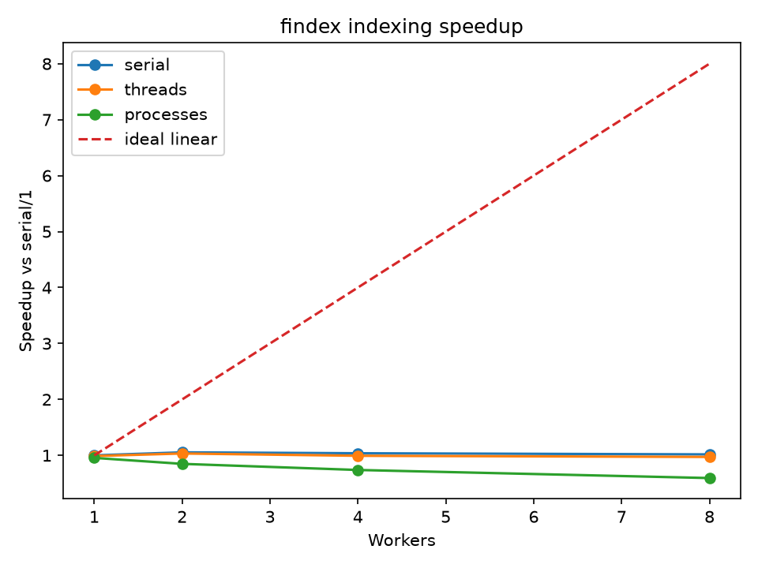

# Лабораторна №5 — Конкурентність і GIL

Додано `src/findex/parallel.py` (модульний воркер `build_partial`, детерміноване `merge`,
`build_parallel`) і прапорці CLI `--workers N --executor {serial,threads,processes}`.
Шляхи передаються воркерам замість прочитаних документів. Для процесів використовується
`multiprocessing.get_context("spawn")`, а помилки `executor.map` передаються викликачу.

## Демонстрація

```bash
git switch main
git pull origin main
python -m pip install -e .
python -m pip install pytest matplotlib psutil
python scripts/generate_demo_corpus.py
findex index data/demo --out serial.bin --workers 1 --executor serial
findex index data/demo --out threads.bin --workers 4 --executor threads
findex index data/demo --out processes.bin --workers 4 --executor processes
python -m pytest tests/test_parallel_lab05.py
python scripts/benchmark_lab05.py data/demo --repeats 3
```

Бенчмарк створить `benchmarks/lab05/measurements.csv` та `speedup.png`.
Після запуску додайте фактичні результати й графік у GitHub, підставте дані в таблицю нижче.
Мінімум три повтори на кожну конфігурацію (медіани).
`serial/1` використовується як база для прискорення.
`os.cpu_count()` визначає додаткову точку з кількістю логічних CPU.

| Executor | Workers | Wall, s | CPU, s | RSS, KiB | Speedup |
|---|---:|---:|---:|---:|---:|
| serial | 1,2,4,8,cpu_count | запустити | запустити | запустити | запустити |
| threads | 1,2,4,8,cpu_count | запустити | запустити | запустити | запустити |
| processes | 1,2,4,8,cpu_count | запустити | запустити | запустити | запустити |

**Метрики Linux:** CPU — витрачений час процесора батьківського та завершених дочірніх
процесів через `resource.getrusage`; RSS — максимум із high-water marks батьківського
і найбільшого дочірнього процесу (KiB), **не сумарний одночасний RSS групи**.
Для сукупного RSS потрібен окремий профайлер групи процесів. Виміри на користувацькому корпусі
поки що не виконані.

## GIL — пояснення

- За звичайного CPython із GIL потоки не виконують Python bytecode CPU-bound
  паралельно; тому індексація з активною токенізацією може не прискоритися.
- Процеси мають окремі інтерпретатори й можуть працювати на кількох ядрах,
  але запуск, серіалізація даних та об'єднання постингів додають накладні витрати.
- Для операцій очікування I/O потоки часто доречніші.
- Закон Амдала: якщо частка роботи залишається послідовною, прискорення має межу.
- Збірка CPython 3.13 free-threaded без GIL (опційний експеримент) перевіряється
  через `sys._is_gil_enabled()`, якщо метод доступний.

## Перевірки

`tests/test_parallel_lab05.py` порівнює serial/threads/processes,
перевіряє відсортованість, інваріант merge, дублікати doc_id та помилки воркера.
Після успішного запуску, доповнення замірів і README можна створювати тег `lab-05`.
Теги попередніх лабораторних не змінюються.
## Результати лабораторної №5

Порівняння послідовної, багатопотокової та багатопроцесної індексації.

| Режим | Workers | Час, с | Прискорення |
|---|---:|---:|---:|
| Serial | 1 | 0.896 | 1.00x |
| Threads | 4 | 0.903 | 0.99x |
| Processes | 4 | 1.212 | 0.74x |
| Processes | 8 | 1.507 | 0.59x |

### Графік прискорення



### Висновок

Для демонстраційного корпусу послідовна індексація
виявилася швидшою за багатопроцесну.

Потоки не дали суттєвого прискорення через GIL,
а процеси мали додаткові витрати на створення
та об'єднання результатів.
